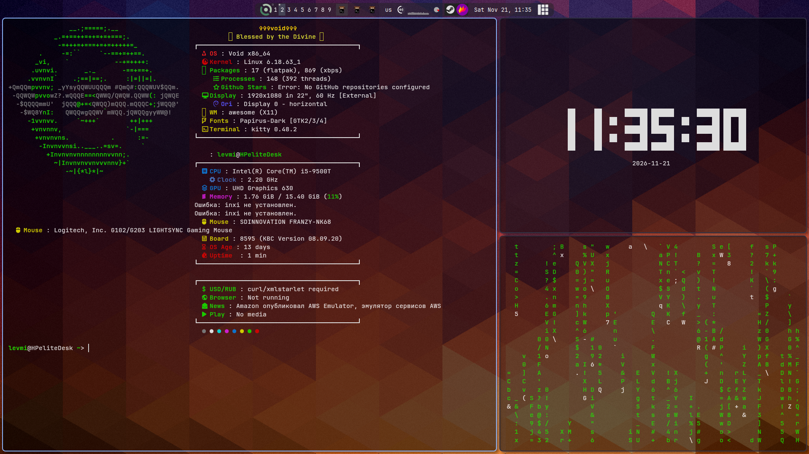

# awesome-config
My awesome awesomeWM config

# requires
awesome wm widgets (https://github.com/streetturtle/awesome-wm-widgets), rofi, picom (mb kitty if you dont want to chage config)

# binds
rofi -- (win + r);
run prompt -- (win + p);
close window -- (win + c);
terminal (by default kitty) -- (win + q);
browser (google) -- (win + b);
keyboard layout -- (win + space);
change tiling mode bind removed

# screenshots

# instalation

Download files rc.lua and theme.lua and put them in place of your same files

# other

wallparer is set by command "feh --bg-fill /your/file.png"
